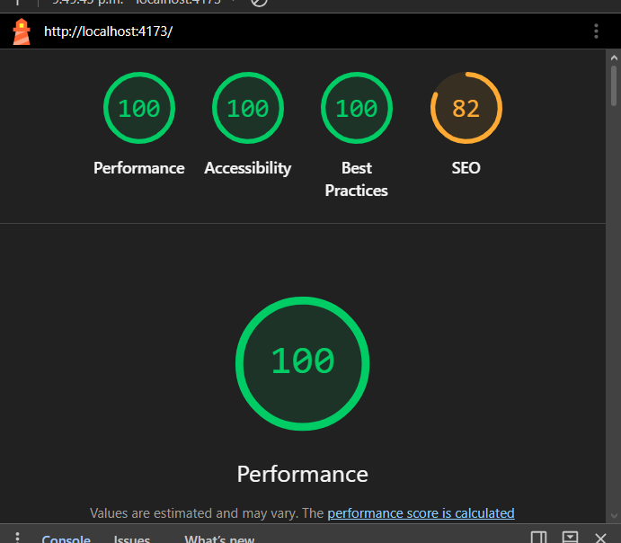
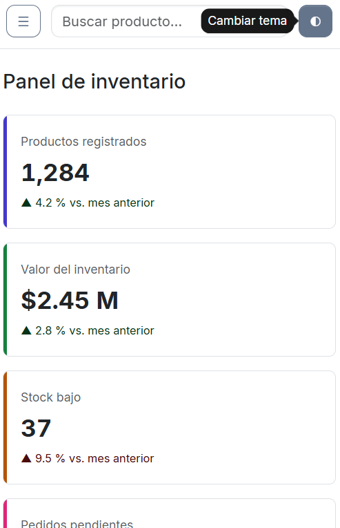
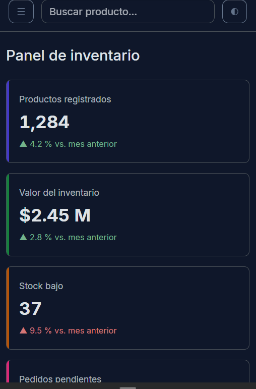
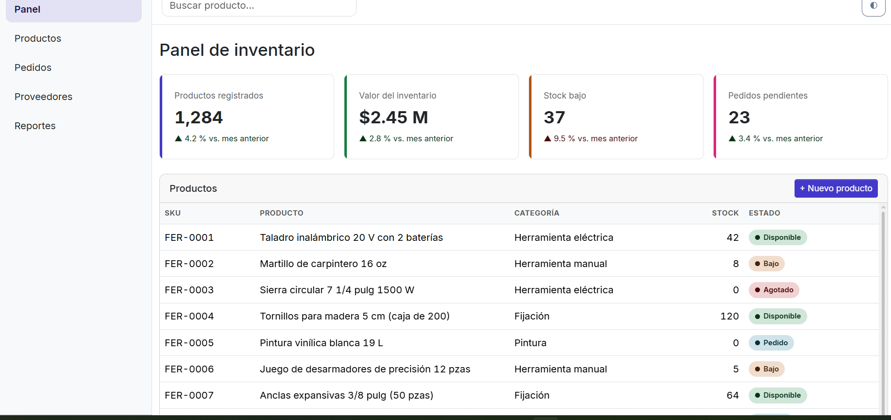
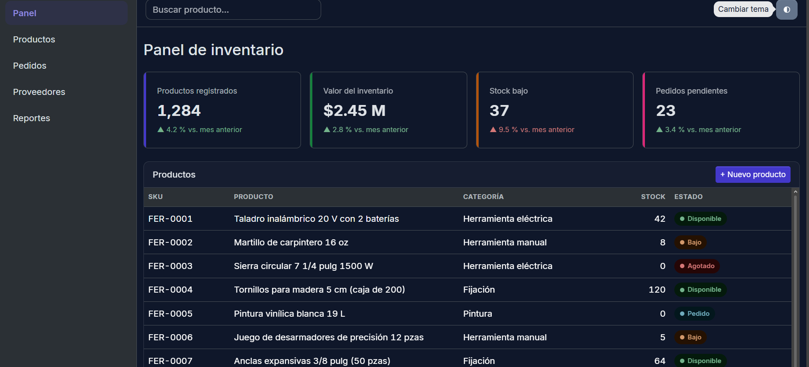

# StockLab

Panel administrativo de inventario hecho con Bootstrap 5.3 compilado desde SCSS, Vite y JavaScript vanilla.

**URL pública:** https://TU-URL-AQUI

## Comandos

- `npm install`: instala dependencias
- `npm run dev`: servidor de desarrollo
- `npm run build` / `npm run preview`: build y vista previa de producción
- `npm run lint:css`: Stylelint

## Retos resueltos

- [x] Reto 1: función `z()` con `@error`, usada en la barra superior
- [x] Reto 2: medición de tamaño de CSS
- [ ] Reto 3
- [x] Reto 4: estado "descontinuado" agregado solo desde `_tokens.scss`
- [ ] Reto 5
- [x] Reto 6: buscador y KPI de stock bajo

## Reto 2: tamaño del CSS

| Versión | Sin comprimir | gzip |
|---|---|---|
| Bootstrap completo | 228.69 kB | 31.73 kB |
| Importación selectiva | 186.55 kB | 26.23 kB |

Ahorro: 42.14 kB (18.4 %) sin comprimir y 5.50 kB (17.3 %) en gzip. El ahorro es moderado porque la mayor parte del peso son las utilidades de Bootstrap, que sí se usan; lo que se quitó fueron componentes que StockLab no necesita.

## Capturas

| | Claro | Oscuro |
|---|---|---|
| 375 px |  |  |
| 1440 px |  |  |

## Reflexión

1. **¿Por qué sobrescribir antes de `variables.scss` y qué hace `!default`?** Bootstrap declara sus variables con `!default`, que significa "asigna este valor solo si la variable aún no existe". Si defino `$primary` antes, Bootstrap respeta mi valor y lo usa para calcular mapas y utilidades. Si lo defino después, esos cálculos ya se hicieron con el valor por defecto.
2. **`@use` vs `@import`:** `@use` carga cada archivo una sola vez y crea un espacio de nombres (`t.$brand`), así que no hay colisiones. `@import` lo mete todo en el ámbito global y recompila el archivo cada vez que se importa.
3. **Variable CSS vs variable Sass:** una variable CSS fue indispensable en `var(--bs-body-bg)` de las tarjetas KPI, porque cambia en el navegador al alternar `data-bs-theme`. Una variable Sass fue mejor en `$stock-states`, porque `@each` genera las clases de los badges al compilar.
4. **`@extend %pill`:** evita repetir estilos y no genera una clase en el CSS final, porque el placeholder solo agrupa selectores. Con clases normales, `@extend` reescribe selectores por todo el CSS, puede producir selectores enormes y alterar el orden de la cascada.
5. **Ahorro y riesgo:** según mi tabla ahorré 42.14 kB (18.4 %) de CSS. El riesgo en un equipo grande es que alguien use un componente que ya no se importa (por ejemplo, dropdown) y no tenga estilos, por lo que hay que documentar la lista de imports.